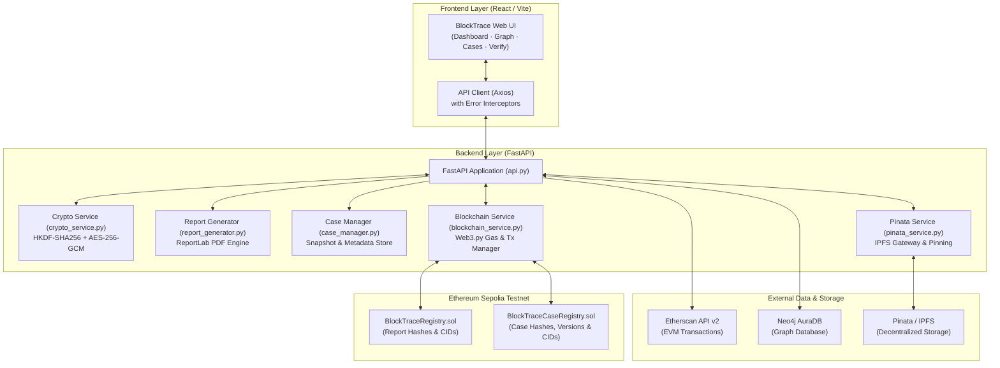

# BlockTrace: Autonomous Blockchain Forensic Intelligence Platform

BlockTrace is a full-stack, tamper-evident blockchain forensic intelligence and investigation platform that reconstructs, analyzes, and visualizes complex illicit cryptocurrency transaction networks across EVM blockchains. By combining high-performance multi-hop graph querying in Neo4j with automated forensic heuristics, OFAC SDN sanctions screening, cryptographic findings certification, and immutable decentralized ledger anchoring, BlockTrace empowers financial intelligence units, law enforcement agencies, and compliance officers to transform raw blockchain data into tamper-evident evidentiary dossiers.

> **Note**: Ethereum Sepolia is a public testnet; testnet transactions and tokens carry no real economic value.

---

## Key Features

- **Multi-Hop Graph Tracing**: Interactive directed transaction graphs rendered in real-time, mapping funds through intermediate hops, contracts, and bridges with dynamic depth control and wallet labeling.
- **Forensic Detection Heuristics**: Automated algorithmic pattern detection flagging:
  - *Peeling Chains*: Rapid, asymmetric passthrough transactions characteristic of money laundering.
  - *Dispersal / Fan-Out*: High-frequency rapid distribution of funds to multiple fresh or burner wallets.
  - *Layering & Cycles*: Circular fund routing designed to obfuscate origin and artificially inflate transaction counts.
  - *Mixer & Bridge Touchpoints*: Direct and indirect hops to known mixers (e.g., Tornado Cash) and cross-chain bridges.
- **OFAC Sanctions Screening**: Case-insensitive screening of every discovered address against a dated snapshot of the U.S. Treasury OFAC SDN list (all EVM `0x` addresses, treated as sanctioned on Ethereum, BNB Chain and Polygon alike), plus a few hand-annotated entries such as the Lazarus Group's Ronin exploiter. The snapshot lives in `data/sanctions_ofac.json`; its publication date and size are shown in the UI, the PDF dossier and `/sanctions/check`. It is not a live feed — see [Refreshing the OFAC sanctions list](#refreshing-the-ofac-sanctions-list).
- **Date-Scoped Traces**: Each wallet contributes at most *Tx / Wallet* transactions (default 15) to a trace, so a trace is a sample, not the full history. Set a *From / To date* window around the incident and choose *Oldest first* to see the earliest activity in that window. The scope (dates, order, cap, hops, chain) is shown above the graph, saved with each case and printed in the PDF dossier, and wallets that hit the cap are marked.
- **Cryptographic Findings Certificates**: Deterministic, structured findings metadata signed and digested using SHA-256 to guarantee analytical repeatability.
- **Audit-Ready PDF Dossier Reports**: Vector-rendered PDF forensic reports containing executive summaries, high-risk wallet catalogs, and forensic heuristic breakdowns.
- **Workspace Case Manager**: Persistent investigation case manager supporting case naming, customized case numbers (e.g., `BT-2026-0001`), graph session saving, loading, versioning, and catalog indexing.

> **Shared Workspace Notice**: The graph view is a single shared investigation workspace. Because saved cases and reports capture everything currently active in the workspace, always click **Clear** (top right) before starting a new investigation to avoid commingling unrelated transaction graphs.

---

## Blockchain & Decentralized Storage Capabilities

BlockTrace bridges local off-chain investigations with the immutability of public blockchain networks:

1. **Decentralized PDF Report Publishing**:
   - The FastAPI backend compiles tamper-evident investigation dossiers into standardized PDF documents.
   - Computes a deterministic SHA-256 fingerprint (`investigation_hash`) of the findings and binary payload.
   - Pins the report PDF to IPFS via Pinata, returning an immutable Content Identifier (CID).
   - Anchors the tuple `(bytes32 investigationHash, string ipfsCID, address submitter, uint256 timestamp)` onto the Ethereum Sepolia testnet via the [`BlockTraceRegistry`](contracts/BlockTraceRegistry.sol) smart contract.

2. **Server-Side Encrypted Case Anchoring**:
   - Allows investigators to archive entire active investigation sessions (graph topology, node classifications, sanctions hits, investigator notes).
   - Computes a plain SHA-256 hash over the canonical JSON snapshot to serve as the public on-chain fingerprint.
   - Performs server-side encryption by the FastAPI backend before IPFS upload (AES-256-GCM, HKDF per-case key) with authenticated associated data (AAD) bound to the case number.
   - Uploads the encrypted envelope (`<case_number>.enc`) to Pinata IPFS as `application/octet-stream`.
   - Records the state on Sepolia via [`BlockTraceCaseRegistry`](contracts/BlockTraceCaseRegistry.sol), storing `keccak256(case_number)` for privacy alongside the plaintext hash and IPFS CID.
   - Supports multi-version anchoring (`v1`, `v2`, etc.) when an active investigation is updated.

3. **Public Independent "Verify Report" Portal**:
   - A dedicated public portal (the Verify Report page) that anyone (judges, regulators, compliance auditors) can access without logging in, having a Web3 wallet, or holding private keys.
   - Users provide the received PDF and the investigation hash to verify against the Sepolia smart contract and IPFS in milliseconds.

---

## Architecture Diagram



---

## How the Proof Works

BlockTrace implements a tamper-evident evidentiary proof architecture that guarantees cryptographic authenticity while respecting operational confidentiality.

### 1. What is Stored On-Chain (Sepolia Testnet)
The smart contracts store **hashes and metadata pointers only**:
- `investigationHash` or `caseDataHash`: 32-byte SHA-256 digest of the unencrypted dossier/snapshot.
- `ipfsCid`: String identifier pointing to the pinned resource on IPFS.
- `submitter`: Ethereum address of the investigator or institutional wallet that anchored the record.
- `timestamp`: Block timestamp recorded by network consensus.
- `caseNumberHash`: `keccak256(case_number)` for cases, ensuring plaintext identifiers never appear in public transaction logs.
- `version`: Monotonically increasing version counter (`uint256`) per case.

### 2. What is Stored on IPFS (Pinata)
- **Forensic PDF Reports**: Publicly accessible PDF documents intended for court submission or compliance sharing. Anyone with the CID can download and read the report.
- **Case Snapshots**: Uploaded as `<case_number>.enc` containing a JSON envelope with an AES-256-GCM ciphertext, 12-byte random nonce, and algorithm version. **Without the master encryption key, the IPFS payload is indistinguishable from random bytes.**

### 3. How Verification Works
- **For Reports**: The registered on-chain fingerprint is the `investigation_hash`. When a user submits a PDF and the investigation hash on the Verify portal, the portal queries the Sepolia contract for that hash to retrieve the registered `ipfsCid`. It then downloads the canonical PDF from IPFS and performs a **byte-for-byte comparison** against the uploaded file. If the bytes match, authenticity is confirmed (`AUTHENTIC`). If the bytes differ, tampering is flagged (`TAMPERED`).
- **For Cases**: The on-chain fingerprint is the SHA-256 of the plain canonical snapshot (`caseDataHash`). When verifying a case, the backend fetches the `<case_number>.enc` envelope from IPFS, decrypts it using the case key derived from `CASE_ENCRYPTION_KEY`, computes the SHA-256 of the decrypted payload, and confirms that:
  $$\text{local\_hash} == \text{on\_chain\_hash} == \text{decrypted\_hash}$$

### 4. What Can and Cannot Be Proven

| Can Be Proven (Mathematically Guaranteed) | Cannot Be Proven (Scope Boundaries) |
|---|---|
| **Existence**: The investigation findings existed in that exact state on or before the block timestamp. | **External Truth**: The blockchain proves data integrity of the report, not whether off-chain allegations are factual. |
| **Authenticity**: Not a single character, wallet, or figure in the PDF or snapshot has been altered (a 1-bit change creates a completely different SHA-256). | **Private Case Decryption**: External third parties cannot view raw case graph snapshots without the investigator's `CASE_ENCRYPTION_KEY`. |
| **Provenance & Identity**: The exact Ethereum address that published or anchored the finding is verified via ECDSA signature. | **Transaction Reversibility**: On-chain anchors cannot be deleted, altered, or wiped from Sepolia. |

---

## Setup From Scratch

### Prerequisites
- **Node.js**: v18.0.0 or higher ([Download](https://nodejs.org/))
- **Python**: v3.10 or higher ([Download](https://www.python.org/))
- **Git**: Installed and configured on your system
- **Neo4j AuraDB**: Free cloud instance ([console.neo4j.io](https://console.neo4j.io))
- **Pinata Account**: Free IPFS account with API JWT and a dedicated gateway domain ([pinata.cloud](https://www.pinata.cloud))
- **Etherscan API Key**: Free developer account ([etherscan.io](https://etherscan.io))
- **MetaMask / EVM Wallet**: Dedicated testnet wallet funded with Sepolia ETH (use free faucets like [Google Cloud Web3 Faucet](https://cloud.google.com/application/web3/faucet/ethereum/sepolia) or [Alchemy Sepolia Faucet](https://sepoliafaucet.com)).

---

### Step 1: Clone or Open the Repository
```bash
# If you have not cloned the repository yet:
git clone https://github.com/aasifahmed56-glitch/BlockTrace.git
cd BlockTrace

# If working from an existing local directory:
cd "D:\BLOCKTRACE 3"
```

---

### Step 2: Set Up Python Virtual Environment & Dependencies
```bash
# Windows
python -m venv venv
.\venv\Scripts\activate

# macOS / Linux
python3 -m venv venv
source venv/bin/activate

# Install dependencies
pip install -r requirements.txt
```

---

### Step 3: Install Frontend Dependencies
```bash
cd stitch_universal_build_framework
npm install
cd ..
```

---

### Step 4: Generate Master Encryption Key
Generate a 256-bit base64 master key for server-side case snapshot encryption:
```bash
python generate_key.py
```
Copy the printed `CASE_ENCRYPTION_KEY=...` line into your `.env` file.

---

### Step 5: Configure Environment Variables (`.env`)
Create a `.env` file in the project root by copying `.env.example`:
```bash
cp .env.example .env
```
Fill in the following variables:

| Variable | Description |
|---|---|
| `ETHERSCAN_API_KEY` | Etherscan API key used to fetch EVM transaction histories and logs. |
| `NEO4J_URI` | Neo4j Aura connection URI (e.g., `neo4j+s://xxxxxxxx.databases.neo4j.io`). |
| `NEO4J_USER` | For Neo4j AuraDB, this is your Instance ID (e.g., `xxxxxxxx`) or `neo4j`. |
| `NEO4J_PASSWORD` | Password for your Neo4j database instance. |
| `NEO4J_DATABASE` | Target Neo4j database name (for Neo4j AuraDB, this is your Instance ID, e.g., `xxxxxxxx`). |
| `PINATA_JWT` | Pinata API JWT token with pinFileToIPFS permissions. |
| `PINATA_GATEWAY` | Dedicated gateway domain from the Pinata dashboard (e.g., `https://xxxx.mypinata.cloud`). |
| `SEPOLIA_RPC_URL` | Ethereum Sepolia testnet JSON-RPC endpoint URL. |
| `CONTRACT_ADDRESS` | Deployed address of the `BlockTraceRegistry` smart contract on Sepolia. |
| `CASE_CONTRACT_ADDRESS` | Deployed address of the `BlockTraceCaseRegistry` smart contract on Sepolia. |
| `WALLET_PRIVATE_KEY` | Hex-encoded private key of the Sepolia deployer/submitter wallet (accepted both with or without the leading `0x` prefix). |
| `CASE_ENCRYPTION_KEY` | Base64-encoded 32-byte AES-256 master key generated via `python generate_key.py`. |

---

### Step 6: Deploy Smart Contracts to Sepolia

1. Open [Remix Ethereum IDE](https://remix.ethereum.org).
2. Create `BlockTraceRegistry.sol` and paste code from [`contracts/BlockTraceRegistry.sol`](contracts/BlockTraceRegistry.sol).
3. In the Remix **Solidity Compiler** tab:
   - Choose compiler version: **`0.8.34`**
   - Optimization: **OFF** (disabled, default 200 runs)
   - Click **Compile BlockTraceRegistry.sol**
4. In the **Deploy & Run Transactions** tab:
   - Environment: **Injected Provider - MetaMask**
   - Connect your Sepolia account (ensure it has testnet ETH)
   - Click **Deploy** and confirm the transaction in MetaMask
5. Copy the deployed contract address and paste into `.env` as `CONTRACT_ADDRESS`.
6. Repeat the process for [`contracts/BlockTraceCaseRegistry.sol`](contracts/BlockTraceCaseRegistry.sol) (compiler `0.8.34`, optimization **OFF**) and paste its address as `CASE_CONTRACT_ADDRESS`.
7. *(Optional)* Verify contract source code on Sepolia Etherscan:
   - Compiler Type: **Solidity (Single file)**
   - Compiler Version: **`v0.8.34`**
   - Open Source License: **MIT License (MIT)**
   - Optimization: **No** (OFF)

---

### Step 7: Start the Backend & Frontend Servers

**Terminal 1 — FastAPI Backend**:
```bash
# In project root with venv activated
python -m uvicorn api:app --host 127.0.0.1 --port 8000
```
Backend API will be live at `http://127.0.0.1:8000` (interactive OpenAPI docs at `http://127.0.0.1:8000/docs`).

**Terminal 2 — React / Vite Frontend**:
```bash
cd stitch_universal_build_framework
npm run dev
```
Frontend interface will be live at `http://localhost:5173`.

---

## Security Notes

1. **Dedicated Testnet Wallet Only**: Never use a wallet private key that controls real funds or mainnet assets. Keep a dedicated throwaway testnet wallet funded only with Sepolia ETH.
2. **Never Commit Secrets**: Ensure `.env` is never staged or committed to Git. The repository includes `.env`, `cases/`, and credentials in [`.gitignore`](.gitignore).
3. **Master Key Backup**: Store your `CASE_ENCRYPTION_KEY` in a secure password manager. If this key is lost, encrypted case snapshots stored on IPFS cannot be decrypted.
4. **IPFS is Public**: All data uploaded to IPFS is accessible to anyone with the CID. PDF reports are public by design, while case snapshots are encrypted with AES-256-GCM before upload.
5. **Immutability of On-Chain Records**: Transactions submitted to Sepolia are permanent. Ensure case numbers and report parameters are accurate before anchoring.

---

## Troubleshooting Guide

### 1. Neo4j Routing / Database Name Errors
- **Symptom**: `Unable to retrieve routing information` or `Database does not exist: neo4j`.
- **Cause**: Neo4j Aura instances require `neo4j+s://` and use the Aura Instance ID (e.g. `xxxxxxxx`) as the database name, rather than the default `neo4j`.
- **Fix**: In `.env`, ensure `NEO4J_URI` starts with `neo4j+s://` and set both `NEO4J_DATABASE` and `NEO4J_USER` to your Aura Instance ID.

### 2. Stale Backend Process on Port 8000
- **Symptom**: `[Errno 10048] error while attempting to bind on address ('127.0.0.1', 8000): only one usage of each socket address is normally permitted`.
- **Cause**: A background uvicorn or python process is still bound to port 8000.
- **Fix (Windows PowerShell)**:
  ```powershell
  Get-NetTCPConnection -LocalPort 8000 -ErrorAction SilentlyContinue | ForEach-Object { Stop-Process -Id $_.OwningProcess -Force }
  ```
  Or identify the PID using netstat and terminate it:
  ```powershell
  netstat -ano | findstr :8000
  Stop-Process -Id <PID> -Force
  ```
- **Fix (macOS/Linux)**:
  ```bash
  lsof -ti:8000 | xargs kill -9
  ```

### 3. Missing Dependencies (`web3`, `python-multipart`, `cryptography`)
- **Symptom**: `ModuleNotFoundError: No module named 'web3'` or `No module named 'cryptography'` or `multipart/form-data requires python-multipart`.
- **Fix**: Re-run `pip install -r requirements.txt` inside your active virtual environment.

### 4. Pinata Dedicated Gateway Configuration & Download Handling
- **Symptom**: Direct requests to `gateway.pinata.cloud` fail with 403 Forbidden or 405 Method Not Allowed.
- **Cause**: Pinata now requires dedicated gateways (`xxxx.mypinata.cloud`) for IPFS content retrieval.
- **Fix**: Set `PINATA_GATEWAY` in `.env` to your dedicated gateway domain from the Pinata dashboard (e.g. `https://xxxx.mypinata.cloud`). In `pinata_service.py`, requests to Pinata gateway domains automatically include `Authorization: Bearer <PINATA_JWT>`. If the primary gateway fails or is unavailable, the service automatically falls back to public gateways (`https://ipfs.io/ipfs/{cid}`, `https://cloudflare-ipfs.com/ipfs/{cid}`).

### 5. Gas Fee Error: `max priority fee per gas higher than max fee per gas`
- **Symptom**: JSON-RPC error `{'code': -32003, 'message': 'max priority fee per gas higher than max fee per gas'}` when broadcasting transactions.
- **Cause**: Sepolia EIP-1559 fee calculation mismatch where suggested priority fee exceeded computed max fee.
- **Fix**: BlockTrace dynamically computes:
  $$\text{maxFeePerGas} = 2 \times \text{baseFeePerGas} + \text{maxPriorityFeePerGas}$$
  with an automatic clamping guard ensuring $\text{maxPriorityFeePerGas} \le \text{maxFeePerGas}$.

### 6. `CASE_ENCRYPTION_KEY` Not Set
- **Symptom**: Anchoring fails with `CASE_ENCRYPTION_KEY is not set in .env`.
- **Cause**: The master AES key has not been generated or added to `.env`.
- **Fix**: Run `python generate_key.py`, copy the output, paste into `.env`, and restart the backend. BlockTrace intentionally blocks anchoring rather than uploading unencrypted snapshots.

---

## Roadmap

- **Multi-Chain Tracing**: Native support for Arbitrum, Optimism, Base, Polygon, and Solana transaction ingestion.
- **Zero-Knowledge Evidence Proofs**: ZK-SNARK attestations allowing compliance officers to prove fund origin compliance without revealing the proprietary graph topology.
- **Decentralized Investigator Credentials (DID)**: W3C DID and ERC-725 integration for institutional signing of forensic reports.
- **Collaborative Multi-Agency Workspaces**: Real-time multi-user investigation rooms secured by threshold cryptosystems and multi-party computation (MPC).

## Refreshing the OFAC sanctions list

`data/sanctions_ofac.json` is generated from the official SDN list published by the
U.S. Treasury OFAC Sanctions List Service
(`https://sanctionslistservice.ofac.treas.gov/api/PublicationPreview/exports/SDN.XML`).
The backend reads this committed snapshot at startup and never downloads the list itself.

```bash
python scripts/update_sanctions.py
```

The script rebuilds the snapshot from scratch, so delisted addresses (such as the Tornado Cash
addresses removed in March 2025) drop out. Commit the regenerated file and redeploy the backend.
Matches are indicators only: always confirm them against official OFAC sources.
